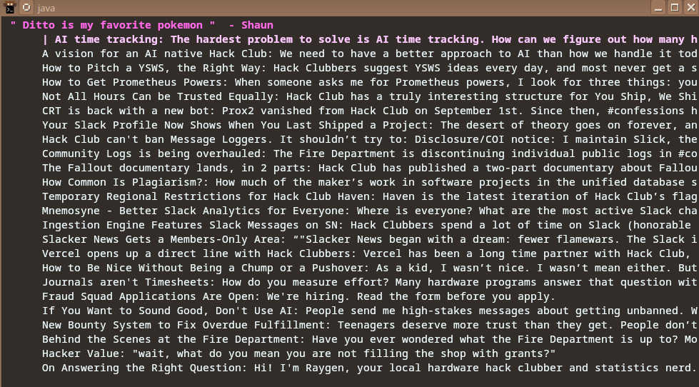

# Shaun's RSS Client
My small Terminal RSS client so I can read slacker news in a very professional format

It's very average, but it gets the job done. There isn't much config options, except being able to change the feeds. I will add more funcitonality later down the line but this is fine for my use for now.

To compile, run:
```
./gradlew build
```
and your compiled stuff will be in /build/distributions! (alternatively, grab from releases)

I personally binded it to a command, so I can run ```news``` and it shows up. 


App Demo:

